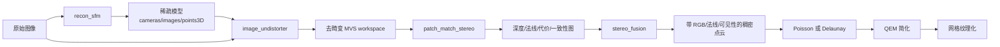

# Colite 架构与重建流程

## 总体分层



稳定的流程边界为：

- `recon_sfm`：原始图像到注册稀疏模型。
- `recon_mvs`：稀疏模型和图像到 dense maps、融合点云和可选表面产物。
- `recon_auto`：从原始图像组合全部独立 stage，默认生成 Poisson 简化纹理网格。

图像去畸变不是几何 SfM 求解的一部分，而是把稀疏模型转换成 MVS 可直接使用的针孔图像 workspace，因此归属 MVS 第一阶段。

## 代码职责

| 目录 | 职责 | 不应包含 |
|---|---|---|
| `core` | 基础 ID、Camera/Image/Point、Pose、Reconstruction、几何和持久线程池 | CLI 参数解析、具体流程编排 |
| `features` | SIFT 后端和统一 `FeatureSet` | pair 选择和两视图几何 |
| `matching` | pair generator、描述子匹配、guided matching、E/F/H 验证 | Mapper 状态 |
| `sfm` | 初始化、注册、三角化、BA、观测管理 | 图像解码和 MVS |
| `mvs` | MVS workspace、PatchMatch、Fusion、网格和纹理 | 命令行别名和 manifest |
| `io` | COLMAP/workspace/PLY 等持久化 | 算法策略 |
| `controllers` | 把算法模块组成单个可执行阶段 | 重复实现算法内核 |
| `exe` | CLI、stage manifest、`recon_auto` 编排 | 大型数学算法 |

## 核心数据结构

- `Camera`：相机模型、尺寸和参数；投影/反投影由统一相机 API 完成。
- `Image`：图像 ID、相机 ID、名称、原始路径、可选位姿、位置先验和 `Point2D`。
- `Point2D`：像素坐标、feature 索引和可选 `Point3DId`。
- `Point3D`：世界坐标、RGB、重投影误差和观测 `Track`。
- `Reconstruction`：Camera/Image/Point3D 的所有权、注册图像集合和一致性修改接口。
- `MatchGraph`：每图特征、原始匹配和已验证两视图几何。
- `MvsImage`：PatchMatch 使用 `[0,1]` 的 `CV_32FC1` 灰度图，Fusion 同时使用 `CV_8UC3` RGB 图。
- `FusedPoint`：三维坐标、法线、RGB、seed 像素和可见图像集合。

像素坐标遵循 COLMAP 的左上像素中心 `(0.5, 0.5)` 约定；与 OpenCV 的 `(0, 0)` 像素中心互换时必须显式偏移。稀疏点 RGB 按 COLMAP 4.0 方式从所有有效 track 观测做双线性采样并求均值；Fusion 对轨迹颜色取稳健统计。

## SfM 单步骤 workspace

`feature_extractor`、matcher 和 `mapper` 通过文件 workspace 解耦：

```text
SFM_WORKSPACE/
  cameras.tsv
  images.tsv
  features/<image_id>.bin
  matches/raw_matches.tsv
  matches/verified_matches.tsv
  matches/summary.txt
  sparse/
    cameras.txt
    images.txt
    points3D.txt
    points3D.ply
    summary.txt
```

特征、匹配、几何和 sparse 阶段使用配置 hash 缓存。修改算法语义时必须更新对应的 `algorithm_version`，否则可能误用旧缓存。性能测试必须使用新的 workspace 或明确清理对应 stage 缓存。

## MVS 与完整流程产物

```text
OUTPUT/
  sfm/
    cameras.txt
    images.txt
    points3D.txt
    points3D.ply
  mvs/
    undistorted/
      images/
      sparse/
      images.tsv
    stereo/
      depth_maps/
      normal_maps/
      cost_maps/
      consistency_graphs*/
      patch_match.tsv
    dense/
      fused.ply
      points_visibility.bin
      fusion_tracks.tsv
  surface/
    meshed-poisson.ply 或 meshed-delaunay.ply
    mesh-simplified.ply
    textured/
      mesh.obj
      mesh.mtl
      texture.png
  .colite/stages/
    <stage>.json
```

Dense map 支持 text 和 COLMAP 风格 binary。`stereo_fusion` 只读取已存在的深度、法线、代价和一致性图，不会隐式重跑 PatchMatch。

## Stage manifest

以下独立命令支持 `--resume`、`--force` 和 `--dry_run`：

- `image_undistorter`
- `patch_match_stereo`
- `stereo_fusion`
- `poisson_mesher`
- `delaunay_mesher`
- `mesh_simplifier`
- `mesh_texturer`

manifest 保存 schema、状态、输入指纹、参数指纹、耗时和声明输出。只有指纹一致且所有声明输出存在时，`--resume` 才跳过；`--force` 强制执行；二者互斥。`--dry_run` 只打印计划，不读取或写入重建产物。

## SfM 数据流

1. 解码图像和相机先验，提取统一 `FeatureSet`。
2. pair generator 生成 exhaustive/sequential/spatial/vocabulary 候选。
3. BF/FLANN 匹配，执行 ratio、cross-check、两视图几何和 guided rematch。
4. Incremental Mapper 选择初始对并注册图像。
5. `IncrementalTriangulator` 先 Continue，再用 point-centric multi-view Create 建点。
6. track complete/merge、局部 BA、过滤和全局 BA 交替执行。
7. 从所有注册观测提取稀疏点 RGB，导出 COLMAP text model 和 PLY。

## MVS 数据流

1. `image_undistorter` 生成 PINHOLE 相机和去畸变彩色图像，并重投影稀疏观测。
2. source-view scoring 结合共享稀疏点、尺度和覆盖率选择视图。
3. CPU/CUDA PatchMatch 估计深度、法线和代价；可启用 bilateral NCC、动态 source probability、directional HMM、CDF source sampling 和几何 refinement。
4. consistency graph 记录每像素的几何一致来源。
5. Fusion 从 seed 出发遍历互相一致的观测，稳健融合位置、法线和 RGB，同时写出可见性。
6. Poisson 使用有向点云；Delaunay 额外使用相机到点的可见射线。
7. QEM 简化保持拓扑和法线约束；Texturer 做视图选择、BVH 遮挡、patch 分组、图集打包、颜色校正和烘焙。

## 流程扩展原则

- 新模块先实现独立控制器和测试，再接入 CLI stage，最后接入 `recon_auto`。
- 一个算法只保留一套参数解析语义；薄包装命令应转发到现有控制器。
- stage 必须明确输入、输出和缓存指纹，不能通过隐式目录猜测修改上游产物。
- 几何结果与显示属性分离：RGB/纹理变化不得影响位姿、深度或网格拓扑判定。
